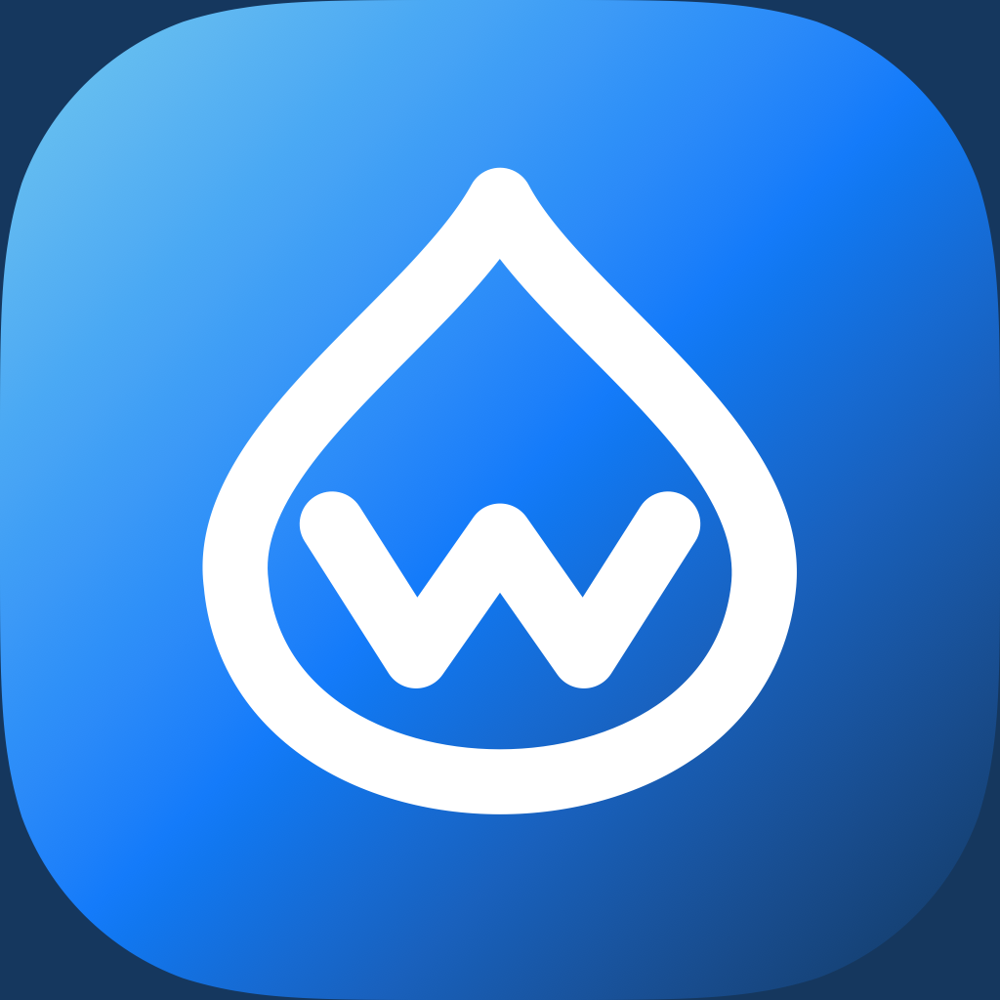
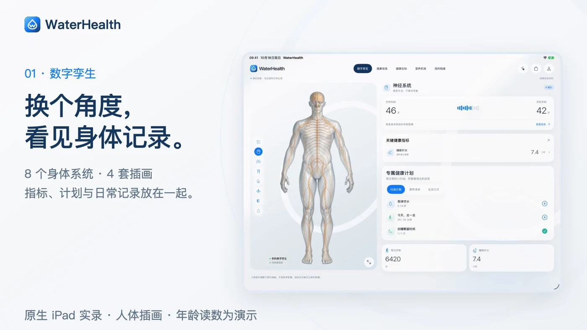
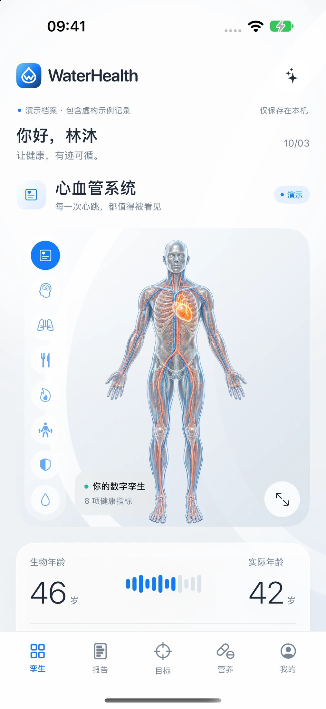
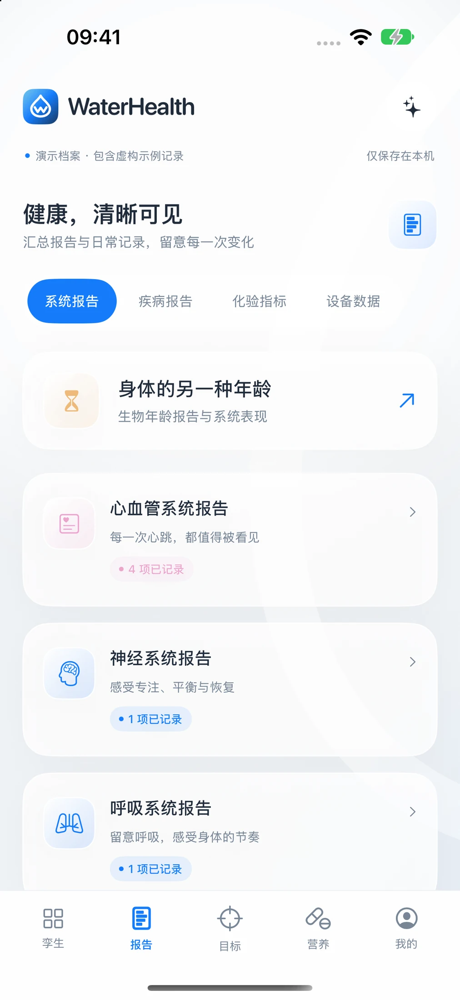
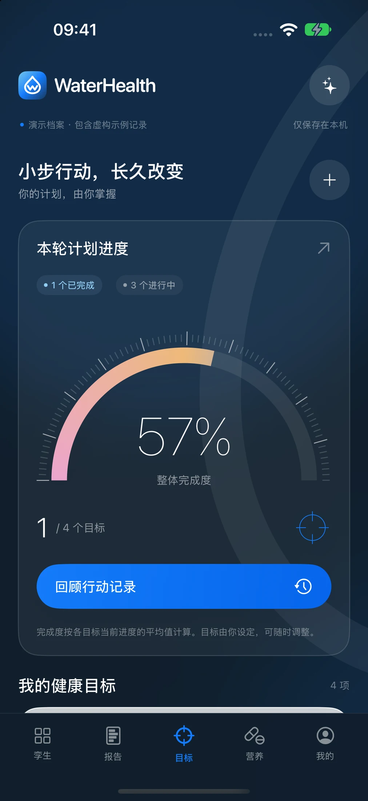
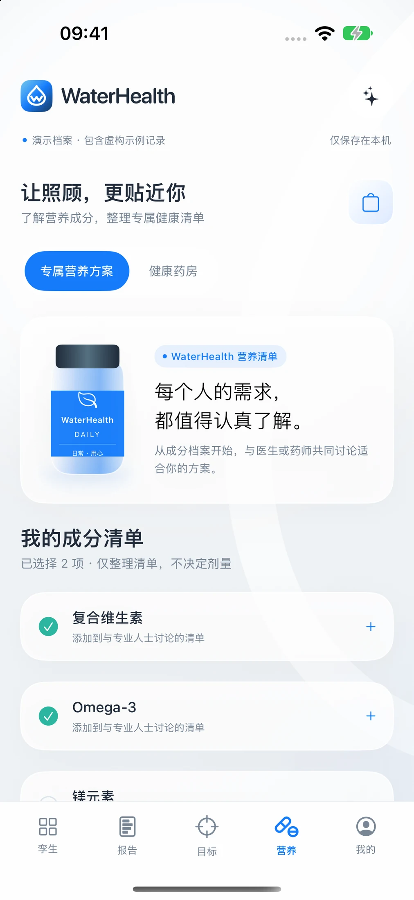
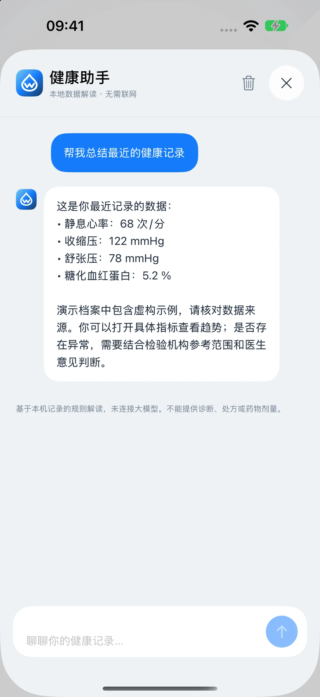
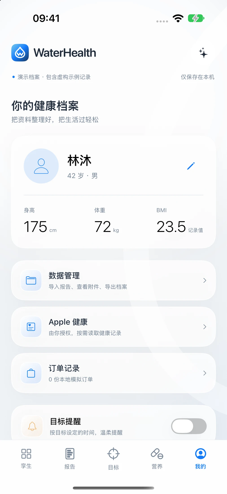
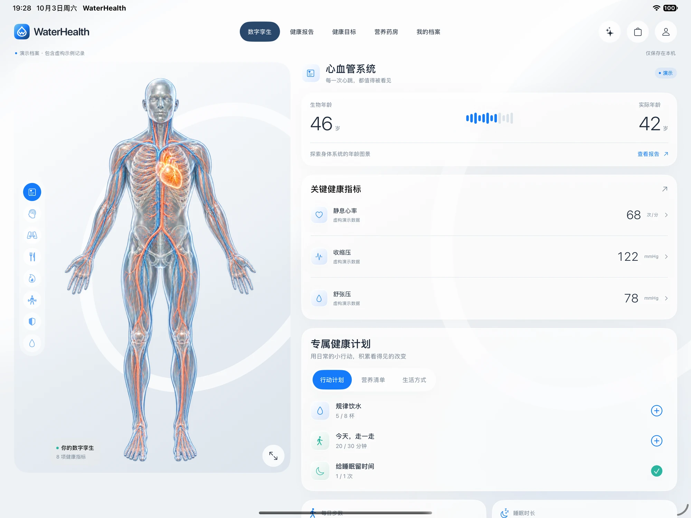
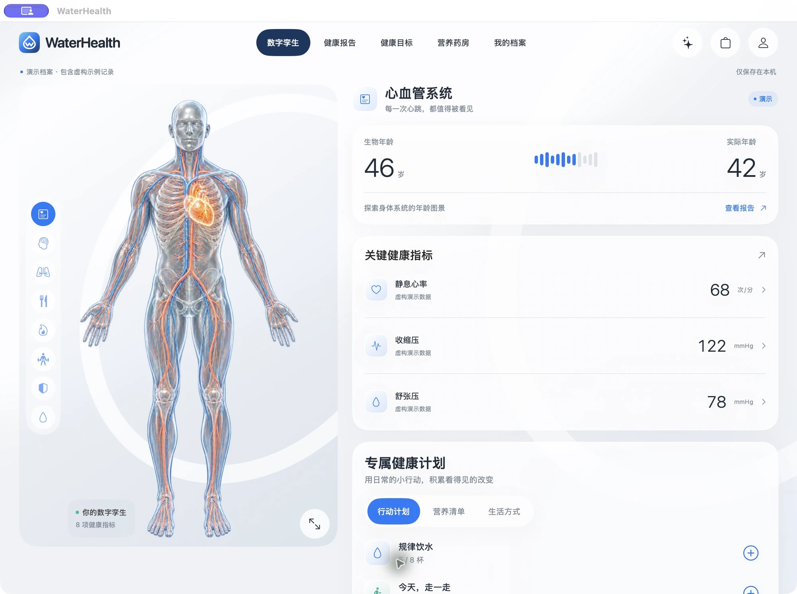

<p align="center"></p>
<h1 align="center">WaterHealth</h1>
<p align="center"><strong>原生记录。留在本机。</strong><br>面向 iPhone、iPad 和 Mac 的中文原生健康记录应用。</p>
<p align="center"><a href="https://waterhealth.knowhappywater.chatgpt.site">产品官网</a> · <a href="https://github.com/David-water/WaterHealth/releases/tag/v1.0.0-preview.1">下载 Mac 体验版</a> · <a href="#产品演示">宣传视频</a> · <a href="README.md">English</a></p>
<p align="center"><a href="https://github.com/David-water/WaterHealth/actions/workflows/ci.yml"></a> <a href="LICENSE"></a></p>

将健康指标、趋势、日常目标和原始报告放进一个原生界面。项目采用 **SwiftUI + Swift Charts**，同时展示共享业务逻辑、本机持久化和平台能力适配的实现方式。**没有后端、云账号、API Key 或第三方应用依赖。**

应用和视频旁白目前为简体中文；仓库同时提供英文文档。应用国际化属于后续可贡献方向。

## 产品演示

[](https://github.com/David-water/WaterHealth/releases/download/v1.0.0-preview.1/WaterHealth-demo-landscape.mp4)

**[观看 / 下载 60 秒横屏宣传片](https://github.com/David-water/WaterHealth/releases/download/v1.0.0-preview.1/WaterHealth-demo-landscape.mp4)** · [竖屏版](https://github.com/David-water/WaterHealth/releases/download/v1.0.0-preview.1/WaterHealth-demo-portrait.mp4) · [完整原生应用演示](https://github.com/David-water/WaterHealth/releases/download/v1.0.0-preview.1/WaterHealth-walkthrough.mp4)

以上为真实运行的原生模拟器录屏，数据均为虚构。安装包、视频和 PDF 放在 Release 中，避免增加源码克隆体积。

## 功能截图

| 身体系统 | 指标与趋势 | 目标与打卡 |
|:--:|:--:|:--:|
|  |  |  |
| 营养清单 | 本地助手 | 个人档案 |
|  |  |  |

<details>
<summary><strong>查看 iPad 与 Mac 界面</strong></summary>

| iPad 横屏 | 原生 Mac |
|:--:|:--:|
|  |  |

</details>

## 当前能力

- **记录与趋势：** 分类查看指标，保留日期、单位和来源，支持手动录入。
- **目标管理：** 创建、编辑、删除目标，打卡、撤销并回顾行动记录。
- **资料管理：** PDF 原始附件、CSV 整批校验导入与去重、JSON 档案导出。
- **本地规则助手：** 总结已有记录和目标，不连接云端大模型。
- **三端适配：** 手机底部导航、iPad 分栏与原生 macOS 窗口。
- **本机存储：** Codable、原子写入、损坏档案保护、iOS 文件保护及 Mac 沙盒。

**能力边界：** 人体插画、年龄和风险读数用于演示，不代表医学评估；营养药房与订单为本地模拟，无支付和发货。PDF 不做 OCR，JSON 暂无恢复导入。目标按本轮累计，不在午夜自动清零。各端独立保存，没有自动云同步。本产品不提供诊断或处方。

## 快速体验

### Mac：无需 Xcode

下载 **[WaterHealth-macOS.dmg](https://github.com/David-water/WaterHealth/releases/download/v1.0.0-preview.1/WaterHealth-macOS.dmg)**，拖入「应用程序」，启动后选择演示档案。

要求 **macOS 14+**，安装包包含 **Apple 芯片与 Intel** 两种架构。当前为 **ad-hoc 签名预览版，未经 Developer ID 签名和 Apple 公证**，首次打开请按 [安装说明](docs/quickstart.md#mac-preview) 操作并核对 Release 校验值。Intel 与最低 macOS 14 未分别实机验证。

### iPhone / iPad：从源码运行

需要完整 **Xcode 26+** 与已安装的 iOS 模拟器。最低支持 **iOS / iPadOS 17**。

```sh
git clone https://github.com/David-water/WaterHealth.git
cd WaterHealth
open ios/WaterHealth.xcodeproj
```

选择 **WaterHealth** Scheme 与 iPhone / iPad 模拟器，点击 Run；开发 Mac 版选择 **WaterHealthMac / My Mac**。首次启动可体验虚构演示档案。

目前没有 TestFlight / App Store 安装入口。真机需自行配置 Apple 签名；HealthKit 读取与通知送达仍需真机验证，Mac 不提供这两项系统集成。

## 开发命令

```sh
make check          # 仓库、文档与静态官网检查
make test           # 6 项业务测试，自动选择可用 iPhone 模拟器
make ios            # 构建未签名模拟器应用
make mac            # 构建原生 Mac 通用 Release
make mac-package    # 本地签名并生成 .build/release/ 中的 DMG / ZIP
make web            # 本地官网 http://127.0.0.1:4173，无需 npm
```

无需后端、数据库、环境密钥、CocoaPods 或 Swift Package 安装。可用 `WATERHEALTH_SIMULATOR=UUID make test` 指定设备。构建产物保存在已忽略的 `.build/` 中。

## 工程结构

```text
ios/WaterHealth/       共享 Core、Design、Features、资源与隐私清单
ios/WaterHealthTests/  业务单元测试
ios/WaterHealthUITests/ 原生 UI 测试
macos/                 Mac 平台配置与沙盒权限
website/               HTML、CSS、JavaScript 与共用截图
scripts/               工程生成、构建、打包及测试脚本
docs/                  架构、安装、使用、验证与素材说明
.github/               CI、Issue 表单与 PR 模板
```

[技术架构](docs/architecture.md) · [安装与签名](docs/quickstart.md) · [产品使用说明](docs/user-guide.zh-CN.md) · [验证与限制](docs/validation.md)

## 参与贡献

欢迎从国际化、真机权限验证、无障碍检查、JSON 版本化恢复等方向参与；这些是**拟议改进方向**，不是已完成的功能。请先阅读 [贡献说明](CONTRIBUTING.md) 与 [路线图](docs/roadmap.md)。Issue 和截图请使用虚构数据。

如果项目对你有帮助，欢迎 Star，让更多 SwiftUI 开发者看到它。

## 许可与致谢

源码与项目原创资产采用 [MIT](LICENSE)。设计参考 **George Railean 的 ClyHealth** 案例；项目与原品牌及设计师没有关联或背书。第三方权利与素材范围见 [NOTICE](NOTICE.md)，视频单独列有 [素材说明](docs/media-credits.md)。
