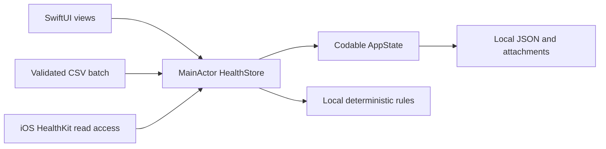

# Architecture

WaterHealth uses Apple system frameworks: SwiftUI, Charts, Foundation, HealthKit (iOS only), UserNotifications (iOS only), UniformTypeIdentifiers and platform document APIs. There are no third-party app packages, servers or API keys.

## Ownership

- `Core/Models.swift`: profile, metrics, readings, goals/logs, checklist, cart/orders and fictional demo fixtures.
- `Core/HealthStore.swift`: main-thread state owner, transactions, persistence, import/export and recovery.
- `Core/CSVImporter.swift`: UTF-8/header/metric/unit/date/value/batch validation.
- `Core/HealthKitService.swift`: authorized read queries and merge; not implemented on Mac.
- `Features/AssistantView.swift` and the local assistant rules in Core: summaries based on current state, without a model endpoint.
- `Design/Theme.swift`: shared color, font and component primitives.
- `Features/`: body-system views, reports, goals, nutrition, profile and onboarding.

Phone navigation is compact; widths of at least 800pt use top navigation and wider layouts. macOS has its own target, Info.plist and sandbox entitlements while reusing SwiftUI/business code under `ios/WaterHealth`.

## Persistence and recovery

`@MainActor HealthStore` publishes `Codable AppState`. A transaction mutates a copy, encodes it and performs an atomic write; UI state changes only after a successful save. The normal archive is `Application Support/WaterHealth/health-records.json`, with separate attachments.

On iOS, archive/attachment writes use complete file protection. Mac uses App Sandbox. Locked-device writes can fail and must be surfaced. Unreadable/unknown-version archives are preserved rather than overwritten silently; explicit replacement first creates a recovery copy. `schemaVersion` is 1, with no JSON restore/import flow yet.

## File contracts

- CSV: fixed header `metric,value,unit,date`, UTF-8, at most 2MB and 1–10,000 rows; reject invalid batches atomically, deduplicate matching reading records.
- PDF: at most 25MB, preserved as the original attachment; no OCR or structured clinical extraction.
- JSON: ISO 8601 dates, archive export only; attachments must be kept separately.
- Goal progress is bounded by the target and records undo/check-in history; it is plan-based, not an automatic midnight reset.
- Simulated order amounts use integer cents; there is no payment or fulfillment integration.

New schema fields need explicit migration/error semantics. Do not replace rules with an LLM or introduce data upload without a separate, explicit product/privacy design.
