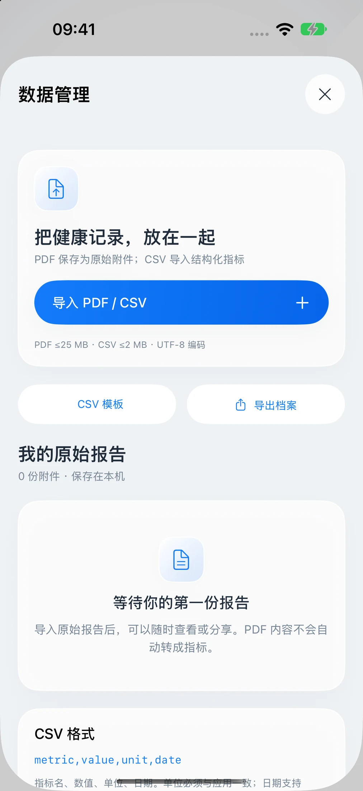

# 产品使用说明

当前版本为中文原生体验版，界面中的演示人物与记录均为虚构。安装步骤见 [quickstart](quickstart.md)。

## 1. 选择档案

首次启动可填写资料，或者选择演示档案快速浏览。创建自己的记录前，请先导出需要保留的资料；切换/替换档案会清理当前记录和附件。

## 2. 查看指标

首页提供八个身体系统入口，使用四套人体插画与位置提示。进入报告分类，点指标查看日期、来源、单位和历史曲线；使用详情页的添加入口手动记录测量。


人体图不是医学影像，年龄/风险读数不是临床计算结果，不应据此诊断。

## 3. 设定目标

进入目标页创建计划，填写目标值，按实际行动打卡；可撤销并查看行动记录。进度按本轮计划累计，不会午夜自动清零。


## 4. 整理营养清单与询问助手

勾选关注的成分，查看商品档案；购物车只能生成本地模拟订单，无支付与发货。右上角星光打开本地助手，输入“目标”等问题，回顾已有记录。助手采用确定性规则，不连接大模型，也不提供处方或药物剂量。

## 5. 管理文件

在「我的 → 数据管理」保存 PDF 原始附件，或使用固定格式导入 CSV 指标：

```csv
metric,value,unit,date
heartRate,68,次/分,2020-01-01
systolic,122,mmHg,2020-01-01
```

数据必须符合模板单位与日期要求；一个批次中出现无效数据时整批拒绝。重复记录会过滤。PDF 不做 OCR；JSON 档案支持导出，暂不能恢复导入，附件需要另存。



各端独立保存在本机，没有云账号或自动同步。iOS HealthKit 读取和提醒需要授权及真机验证；Mac 没有这两项系统集成。
